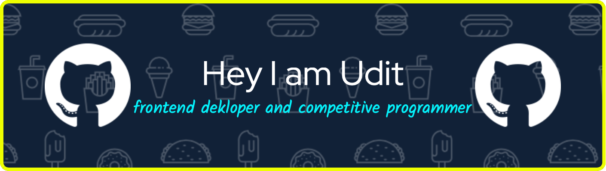

  

  # Hi, I'm Udityanshu 👋

  **Software Engineer · Bangalore, India**

  I enjoy building useful software, exploring AI, and turning ideas into real products.

## A little about me

- 💻 I work across web development and backend systems
- 🌱 Currently exploring .NET and AI-powered applications
- 🤖 Interested in machine learning and practical AI
- 📍 Based in Bangalore, India

## Things I've built

  
  

## Tools I use

  
  
  
  
  
  
  

## GitHub activity

  
  

  

Always learning, always building ✨

